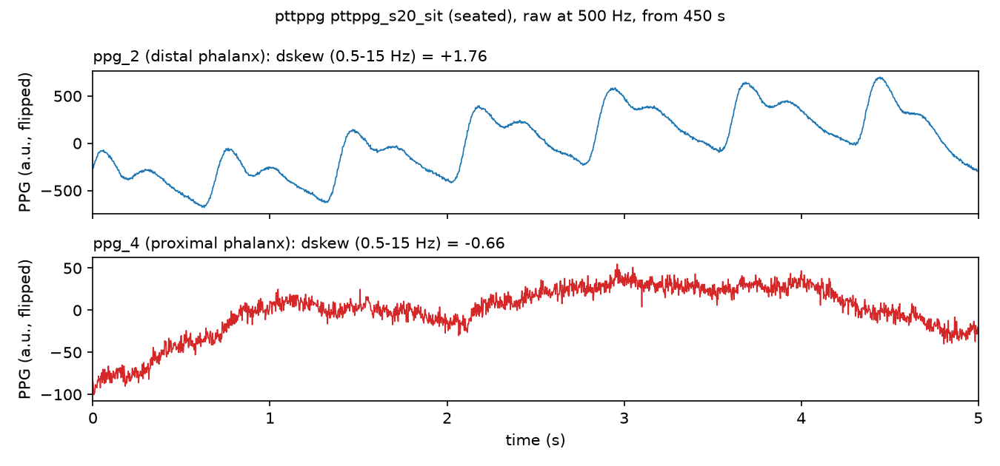
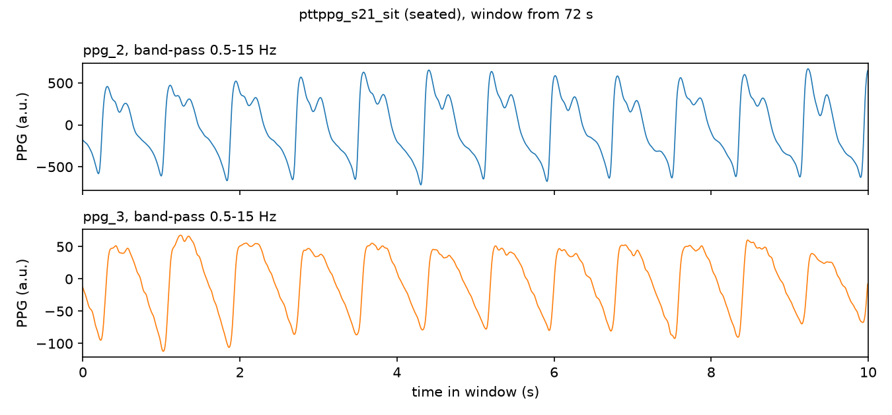
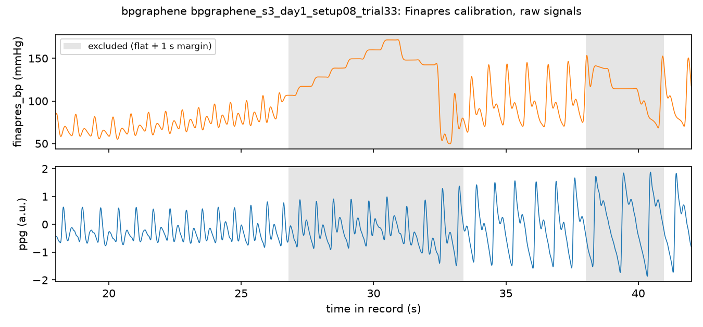
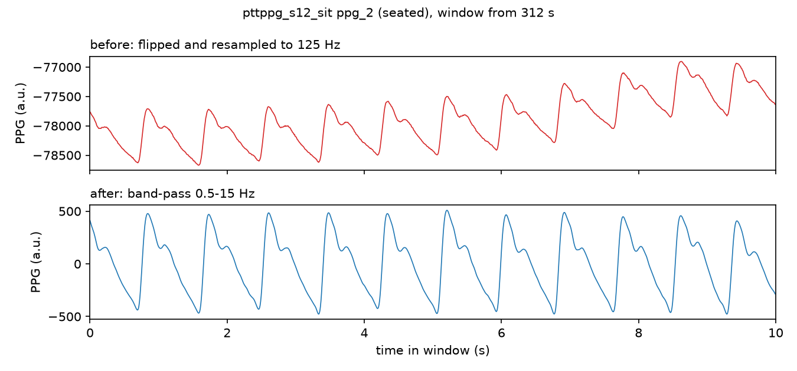

# WiP Test description:

### Overview of the test data

Test Data (`scripts/download_testset.py`, downloaded 2026-11-21):
- ppgbp, mimicbp, pwdb, pttppg, bpgraphene: complete
- pulsedb: 40 random subjects: 20 from MIMIC + 20 from VitalDB

| | ppgbp | pttppg | bpgraphene | mimicbp | pulsedb | pwdb |
|---|---|---|---|---|---|---|
| Condition | seated rest | sitting, stationary walking, running | baseline / rest, hand grip + cold pressor, Valsalva, cycling | ICU | ICU (MIMIC) / surgery (VitalDB) | simulated (one steady-state beat) |
| Native PPG rate | 1000 Hz | 500 Hz | 1250 Hz | 125 Hz | 125 Hz (VitalDB native 500 Hz, downsampled by PulseDB) | 500 Hz |
| Records | 657 | 66 | 260 | 45 720 | 50 (30 MIMIC, 20 VitalDB) | 4374 |
| Record duration, mean (min-max) | 2.1 s (2.1-4.2) | 491 s (484-551) | 88 s (87-189) | 30 s (30-30) | 14 797 s (10-35 990) | 0.8 s (0.7-1.0) |
| Total duration | 0.4 h | 9.0 h | 6.3 h | 381 h | 206 h | 1.0 h |
| Harmonized 10 s windows kept (default config) | 657 (2.1 s each) | 792 | 1765 | 135 622 | 37 114 | 4374 (1 beat each) |

### Brief overview of the harmonization process

Run record by record for each dataset (`harmonize/pipeline.py`); parameters are from `HarmonizeConfig` (`harmonize/config.py`).

1. Select signals
2. Correct PPG orientation
3. Find usable time segments
4. Filter beats by quality
5. Place windows
6. Check beat count per window
7. Cut windows with padding
8. Resample to 125 Hz
9. Band-pass filter the PPG
10. Normalize the PPG (z-score)
11. Compare PPG and pressure wave beat counts
12. Output

### 1. Select signals

**Problem.** The datasets record different sets of signals: some have several PPG channels (pttppg: 6, pwdb: 13 measurement sites), some have a second PPG from another device (bpgraphene: `finapres_ppg`), some have a continuous pressure wave and some only cuff readings. Windows can only be compared across datasets if they contain the same kind of signal.

**Method.** For every dataset exactly one PPG channel, plus the continuous pressure wave if it has one is chosen (`harmonize/sources.py`). Everything else (ECG, flow, area, other PPG channels) is ignored.

| dataset | PPG | pressure wave |
|---|---|---|
| ppgbp | `ppg` (finger) | none (cuff only) |
| pttppg | `ppg_2` (distal phalanx) | none (cuff only) |
| bpgraphene | `ppg` (fingertip) | `finapres_bp` (Finapres, represents brachial BP) |
| mimicbp | `ppg` (finger) | `abp` (arterial line) |
| pulsedb | `ppg` (finger) | `abp` (arterial line) |
| pwdb | `ppg_digital` (finger) | `abp_brachial` |

**Why.**
- *pttppg `ppg_2`*: the channel should have a clean pulse with a typical shape. Cleanness is measured with the derivative skew (dskew) in the 0.5-15 Hz band: a clean pulse rises fast and falls slowly (dskew > 0), noise does not (dskew around 0 or below). The distal channels (1-3) are clearly cleaner than the proximal ones (4-6). Test set, 10 s windows, after the orientation flip (step 2):

  | channel | ppg_1 | ppg_2 | ppg_3 | ppg_4 | ppg_5 | ppg_6 |
  |---|---|---|---|---|---|---|
  | windows with dskew > 0 | 89 % | **92 %** | 97 % | 64 % | 68 % | 86 % |

  Example, as stored in the dataset (500 Hz, only flipped):

  

  `ppg_3` is the cleanest, but its pulse has a broad top with a second peak almost as high as the first. `ppg_1` and `ppg_2` show the pulse wave more clearly (sharp systolic peak, lower second peak) and are closer to the pulse shape of the other datasets.
  Typical window:

  

  The channel is a config parameter (`pttppg_ppg`).
- *bpgraphene `ppg` instead of `finapres_ppg`*: `finapres_ppg` is only sampled at 75 Hz, below the 125 Hz target rate, so it would have to be upsampled.
- *pwdb `abp_brachial`*: pwdb's SBP/DBP labels are the brachial values, so the brachial wave is the one that matches the labels.

### 2. Correct PPG orientation

**Problem.** A PPG can be stored upside down, depending on the sensor and on how the device writes the signal (light absorbed vs. light received). In pttppg every channel shows a slow rise and a sharp drop, the mirror image of a normal pulse wave.

**Method.** Orientation is a fixed property per dataset (`ppg_inverted` in `harmonize/sources.py`, only pttppg). The PPG is multiplied by -1 directly after it is read, before any other step.

**Why.**
- *Per dataset, not per window*: the orientation is a property of the recording hardware, not of a single window. Deciding per window from dskew would flip noisy windows at random, because their dskew is close to 0 or negative without being inverted (figure in step 1).
- *Which datasets are inverted*: checked with dskew on the band-passed signal. Without the flip, ppg_2 of pttppg has dskew < 0 in 59 of 66 records. After harmonization all datasets are correctly oriented.

### 3. Find usable time segments

**Problem.** The selected signals of a record do not contain valid signal at all times:

- *Edges*: in bpgraphene, `finapres_bp` starts ~1 s after the PPG and ends ~1 s before it; some pwdb channels store their last sample as invalid (NaN).
- *Gaps*: PulseDB stores only selected 10 s segments of each recording, with NaN in between. Only about half of a PulseDB record's time axis contains signal.
- *Device calibration*: the Finapres (bpgraphene) recalibrates itself during the recording (Physiocal). For ~0.5-1 s  at a time it holds the pressure at a constant level and records no pulse, while the PPG goes on normally.

A window covering any of these contains PPG without a valid pressure wave, or no signal at all.

**Method.** Each record is split into usable segments: the stretches where all selected signals are valid (`harmonize/segments.py`). Windows (step 5) are placed only inside these segments. Invalid is

- NaN in any selected signal, and
- for bpgraphene only: a pressure wave that stays within 2 mmHg for at least 0.5 s (a calibration), plus 1 s on both sides.

A record without any usable segment is reported as `no_signal`.

**Why.**
- *2 mmHg for 0.5 s*: the calibration levels last 0.5-0.8 s (10th-90th percentile) and drift only slightly, while a real pulse changes by far more than 2 mmHg within 0.5 s.
- *Only for the Finapres*: the calibration only exists for this device. Applying the check to other devices could only remove valid data there.
- *1 s margin*: the beats right next to a calibration are distorted (in the figure: the first beats after the long calibration).

### 4. Filter beats by quality

**Problem.** For bpgraphene, mimicbp and pulsedb the BP labels are calculated per beat from the pressure wave (`structure/beats.py`). That detection only checks whether something is a beat at all (beat length 0.25-2 s, pulse pressure >= 5 mmHg). Artifacts in the pressure wave can still produce beats with values that are physiologically implausible, e.g. a damped or flushed arterial line gives a very small pulse pressure.

**Method.** A calculated beat is dropped if

- SBP is outside 60-250 mmHg,
- DBP is outside 30-150 mmHg, or
- the pulse pressure (SBP - DBP) is below 10 mmHg.

Only the single beat is dropped, not the record. Whether the remaining beats of a window are still enough is checked in step 6.

**Why.**
- *Wide limits*: the limits are meant to remove values that cannot be real, not to remove real hypo- or hypertension. ICU and surgery patients can be hypotensive, so the lower SBP limit is low (60 mmHg). On the test set the 0.1st and 99.9th percentiles of all calculated beats lie well inside the limits (SBP 66-208, DBP 31-135 mmHg), so only the extreme tails are affected.
- *Pulse pressure >= 10 mmHg*: stricter than the 5 mmHg of the beat detection. A pulse pressure this small is typical of a damped arterial line rather than of a real heart beat. It is the most common reason for dropping a beat (see table).
- *The dropped beats are artifacts, not isolated physiological outliers*: most of them come in clusters (another dropped beat within 10 s: 56 % bpgraphene, 91 % mimicbp, 95 % pulsedb), which is the pattern of an artifact episode.

Test set, calculated beats:

| dataset | beats | dropped | SBP < 60 | SBP > 250 | DBP < 30 | DBP > 150 | PP < 10 |
|---|---|---|---|---|---|---|---|
| bpgraphene | 28 297 | 16 (0.06 %) | 0 | 0 | 2 | 6 | 8 |
| mimicbp | 1 839 016 | 475 (0.03 %) | 64 | 0 | 2 | 0 | 434 |
| pulsedb | 486 193 | 1141 (0.23 %) | 77 | 1 | 352 | 7 | 761 |

(A beat can fail several limits, so the columns can add up to more than "dropped".)

### 5. Place windows

**Problem.** The records range from one simulated beat (pwdb, 0.8 s) to ICU recordings of several hours (pulsedb). Pieces of signal of the same length, each with the BP values that belong to exactly that piece, are easier to compare and analyse, across records and across datasets.

**Method.** Non-overlapping 10 s windows inside each usable segment (step 3), each with the BP values of its time (`harmonize/windows.py`): the beats whose onset lies inside it or the nearest cuff reading (only windows within 60 s of a reading). A record shorter than 10 s gives one window of its own length (ppgbp, pwdb; marked `full_length = False`).

**Why.**
- *10 s*: PulseDB's segments are 10 s long and MIMIC-BP's 30 s segments divide evenly into three windows. 10 s holds several beats (median 13 per window on the test set) and is short enough that BP hardly changes inside it. The length is a config parameter (`window_s`).
- *No overlap*: overlapping windows repeat the same signal, so the same beats would be counted several times in any statistic over the windows. The distance between windows is a config parameter (`step_s`) if overlap is wanted later.
- *60 s around a cuff reading*: a cuff reading only describes BP around the moment it was taken. How much SBP changes over time, from the calculated beats (median absolute change in mmHg):

  | time between beats | 10 s | 60 s | 120 s | 300 s |
  |---|---|---|---|---|
  | pulsedb (ICU, at rest) | 3.1 | 3.6 | 4.2 | 5.3 |
  | bpgraphene (exercise protocols) | 5.0 | 7.7 | 13.6 | - |

  Up to 60 s the change stays small; under exercise it roughly doubles after that. The two pttppg readings of a record (~8 min apart) differ by up to 23 mmHg, so one reading cannot label the whole record. The distance is a config parameter (`cuff_window_s`).
- *Short records keep their own length*: ppgbp and pwdb consist only of short records, so dropping them would remove both datasets. The arrays are filled with NaN after the end and the windows are marked, so they can be filtered out.

Windows per dataset on the test set (before the checks of the following steps):

| | ppgbp | pttppg | bpgraphene | mimicbp | pulsedb | pwdb |
|---|---|---|---|---|---|---|
| windows | 657 | 792 | 1801 | 137 160 | 37 588 | 4374 |
| length | 2.1 s | 10 s | 10 s | 10 s | 10 s | one beat |

### 6. Check beat count per window

**Problem.** For windows with beat values, the label is the set of beats inside the window. If beats are dropped in step 4 or not detected, the window has an incomplete label or none at all.

**Method.** Only for windows with beat values. A window is rejected if it has fewer than 0.5 valid beats per second (fewer than 5 beats in 10 s; `too_few_beats`).

**Why.** 0.5 beats/s is 30 bpm, the slowest heart rate the beat detection accepts, so a window with fewer beats has lost beats. On the test set this removes 58 windows: 56 because step 4 dropped their beats, and 2 where the pressurewave has no regular pulse.

### 7. Cut windows with padding

**Problem.** Resampling (step 8) and band-pass filtering (step 9) distort the first and last samples of a signal (edge effects), because the filter has no signal beyond the ends.

**Method.** Each window is cut together with up to 2 s of extra signal (padding) on both sides (`cut` in `harmonize/signals.py`). Steps 8 and 9 run on the padded piece, then the padding is cropped. The padding stops early where the record ends or a gap begins. pwdb's single beat is instead tiled 3x (`cut_periodic`) and the middle copy is kept.

**Why.**
- *2 s*: the same 10 s windows were resampled and filtered (steps 8 and 9) with different padding and compared with a reference cut from a 30 s piece (pttppg and bpgraphene, 960 windows). Error = largest deviation inside the window, in window SDs:

  | padding | 0 s | 0.5 s | 1 s | 2 s |
  |---|---|---|---|---|
  | largest error, median | 0.37 SD | 0.24 SD | 0.02 SD | 0.003 SD |
  | largest error, 95th percentile | 1.2 SD | 0.36 SD | 0.10 SD | 0.008 SD |

  The length is a config parameter (`pad_s`).
- *Not every window gets the full padding*: the first and last window of a record or PulseDB segment usually have none on that side, so their outer ~0.7 s are distorted (median window).
- *pwdb tiled*: the beat is periodic by construction, so the tiled copies are exactly the signal before and after it.

### 8. Resample to 125 Hz

**Problem.** The signals are recorded at different rates, from 125 Hz to 1250 Hz:

| dataset | ppgbp | pttppg | bpgraphene | mimicbp | pulsedb | pwdb |
|---|---|---|---|---|---|---|
| PPG | 1000 Hz | 500 Hz | 1250 Hz | 125 Hz | 125 Hz | 500 Hz |
| pressure wave | - | - | 200 Hz | 125 Hz | 125 Hz | 500 Hz |

A window must have the same number of samples in every dataset, so all signals are brought to one common rate.

**Method.** The padded piece from step 7 is resampled to 125 Hz with `scipy.signal.resample_poly`, PPG and pressure wave alike (`resample` in `harmonize/signals.py`). Signals that are already at 125 Hz are left untouched.

Downsampling means keeping only every n-th sample (e.g. every 4th sample for 500 Hz -> 125 Hz). Before that, a low-pass filter (anti-aliasing filter) removes everything above 62.5 Hz, half the new rate. At 125 Hz such fast content can no longer be represented; without the filter it would show up as false slower content (aliasing). For a ratio that is not a whole number (Finapres: 200 Hz -> 125 Hz = 5/8), the signal is first brought to 5x its rate and then every 8th sample is kept.

**Why.**
- *125 Hz*:
  - It is the native rate of mimicbp and pulsedb, by far the largest datasets (~95 % of all windows). They stay exactly as recorded. A higher rate would only interpolate them and add no information;
  - It is high enough for the signals. The pulse wave itself lies below 15 Hz, far below 62.5 Hz. The power above 62.5 Hz in ppgbp is broadband sensor noise (it is spread over the whole range up to the native Nyquist frequency), not pulse wave.
  - It is a common rate for PPG-based BP estimation (MIMIC, PulseDB), so results can be compared with other work.
- *Anti-aliasing is needed*: taking every 4th sample of pttppg without the low-pass folds its high-frequency noise into the pulse band. After the band-pass (step 9) such a window deviates from the correctly resampled one by 0.04 SD (median of the largest deviation per window, 95th percentile 0.19 SD).
- *Polyphase instead of FFT resampling*: `scipy.signal.resample` works in the frequency domain: Fourier transform of the whole piece, cut the spectrum at the new Nyquist frequency, inverse transform. In the middle of a long piece both methods give a similar result (difference 0.001 SD for the PPG, 0.05 mmHg for the pressure wave). But the Fourier transform treats the piece as periodic: its end is joined to its start. The jump between them, together with the sharp cut of the spectrum, causes ringing that spreads from both edges into the signal. The polyphase filter only uses its neighbouring samples (0.16 s, see below), so its edge effects stay at the edges. Measured as in step 7 (window vs. the same window from a 30 s piece, largest deviation per window, median / 95th percentile):

  | | padding | FFT | polyphase |
  |---|---|---|---|
  | pttppg PPG, after band-pass | 0 s | 0.50 / 1.5 SD | 0.45 / 1.4 SD |
  | | 2 s | 0.004 / 0.009 SD | 0.004 / 0.009 SD |
  | bpgraphene pressure wave | 0 s | 2.8 / 9.0 mmHg | 0.06 / 0.29 mmHg |
  | | 2 s | 0.007 / 0.022 mmHg | 0 mmHg |

  The first and last window of every record and of every PulseDB segment do not have 2 s of padding on both sides. For the PPG both methods are similar there, because the band-pass error of step 9 dominates. For the pressure wave, which is not band-passed afterwards, the polyphase filter is clearly better at these edges.

**Parameters of `resample_poly`.**
- *up, down*: the ratio 125 Hz / native rate as a fraction: 1/10 (1250 Hz), 1/8 (1000 Hz), 1/4 (500 Hz), 5/8 (200 Hz). It is computed automatically; the code stops if a rate has no exact fraction.
- *window* (default: Kaiser window, beta = 5): shapes the anti-aliasing filter. scipy designs it with the cutoff at the new Nyquist frequency as a filter that averages each sample with its neighbours over 0.16 s (20 x max(up, down) + 1 weights, the same duration for all ratios here). The pulse band (up to 15 Hz) passes unchanged. The filter does not switch from "pass" to "block" exactly at 62.5 Hz but over a range (here up to ~72 Hz). Content in that range is only partly removed and folds back onto 53-62.5 Hz, which the band-pass (step 9) removes from the PPG. A larger beta or a longer filter would narrow this range, which is not needed here, so the default is kept.
- *padtype* (default `"constant"`, i.e. zeros): how the signal is continued beyond its ends, which only matters for the first and last ~0.08 s (half the filter length). Set to `"line"` (continued linearly). With zeros, the filter pulls a pressure wave (~80 mmHg) towards 0 at the edges: 19 mmHg error (median) at a window without padding, vs. 0.06 mmHg with `"line"`. For windows with padding it makes no difference, because the edges are cropped.

### 9. Band-pass filter the PPG

**Problem.** Besides the pulse wave, the PPG contains slow baseline changes (breathing, movement, changes in sensor contact) and fast noise (sensor noise, small artifacts). Both differ between devices and datasets. 
Fraction of the PPG power below 0.5 Hz and above 15 Hz, 10 s windows at 125 Hz before filtering, median:

| | pttppg | bpgraphene | mimicbp | pulsedb |
|---|---|---|---|---|
| below 0.5 Hz | 38 % | 1.2 % | 1.9 % | 1.9 % |
| above 15 Hz | 0.12 % | 0.04 % | 0.04 % | 0.05 % |

The high value of pttppg is caused by sensor drift.

Example (pttppg `ppg_2`, seated), before and after this step:

**Method.** The padded, resampled PPG (step 8) is band-pass filtered at 0.5-15 Hz with a 2nd-order Butterworth filter, run forwards and backwards (`scipy.signal.butter(2, (0.5, 15), btype="band", fs=125, output="sos")` and `scipy.signal.sosfiltfilt(..., padtype="even", padlen=125)`, `bandpass` in `harmonize/signals.py`). Then the padding is cropped (step 7). The pressure wave is not filtered.

A band-pass lets the frequencies between its two cutoffs through and removes those below (the baseline) and above (the noise). The filter does not cut sharply: at the cutoffs the signal is reduced to half its amplitude (-6 dB), and the further a frequency lies outside the band, the more it is reduced.

**Why.**
- *Only the PPG*: the pressure wave must keep its values in mmHg, because they are the BP labels (e.g. DBP = 80 mmHg). The band-pass would remove this level and leave only the up and down around 0. The PPG has no unit, so for it only the shape matters.
- *Band 0.5-15 Hz*: supported by two studies.
  - Wolling, Wasala & Van Laerhoven, "Optimal Preprocessing of Raw Signals from Reflective Mode Photoplethysmography in Wearable Devices", 2021, [doi:10.1109/EMBC46164.2021.9630955](https://doi.org/10.1109/EMBC46164.2021.9630955). Broadly related: based on 21 806 labelled pulses, 0.5-15 Hz was "the most suitable but still universal filter passband" for pulse detection on wearable PPG.
  - Dias et al., "Exploring the limitations of blood pressure estimation using the photoplethysmography signal", 2024, [doi:10.1088/1361-6579/adcb86](https://doi.org/10.1088/1361-6579/adcb86). Very similar to this work: BP estimation from PPG with different band-pass filters. 0.5-10 Hz performed close to the unfiltered signal, a narrow 0.5-3.5 Hz clearly worse. 15 Hz keeps even more of the pulse shape than 10 Hz.
- *Order 2*: the order sets how fast the gain drops outside the band. Running the filter twice (forwards and backwards) doubles the effect. Gain of the forwards-backwards filter, and how long its edge effect lasts (time until 99.9 % of the filter's impulse response is over):

  | order | 0.2 Hz (breathing) | 0.67 Hz (40 bpm) | 1 Hz | 10 Hz | 30 Hz | edge effect |
  |---|---|---|---|---|---|---|
  | 1 | -18 dB | -3.7 dB | -1.6 dB | -2.8 dB | -17 dB | 0.6 s |
  | **2** | **-33 dB** | **-2.1 dB** | **-0.4 dB** | **-1.2 dB** | **-31 dB** | **1.1 s** |
  | 4 | -66 dB | -0.7 dB | 0.0 dB | -0.2 dB | -62 dB | 1.8 s |

  Order 1 removes breathing only weakly and already reduces the pulse at 1 Hz. Order 4 is sharper, but its edge effect almost fills the 2 s padding (step 7), and the windows without padding are affected even longer. Order 2 is the compromise.
- *Butterworth instead of other scipy filter types*: the filter types differ in how evenly they treat the frequencies inside the band. Gain of each type at the same band and order (forwards-backwards):

  | filter | 1 Hz | 2 Hz | 8 Hz |
  |---|---|---|---|
  | **Butterworth (`butter`)** | -0.4 dB | 0.0 dB | -0.4 dB |
  | Chebyshev I (`cheby1`) | -0.8 dB | -1.9 dB | -0.7 dB |
  | Elliptic (`ellip`) | -0.8 dB | -1.9 dB | -0.7 dB |
  | Bessel (`bessel`) | -1.9 dB | -0.1 dB | -2.1 dB |

  Butterworth passes all pulse frequencies almost equally, so the pulse keeps its shape. Chebyshev and elliptic filters cut off more sharply at the band edges, but in exchange reduce some frequencies inside the band more than others (ripples), which changes the shape. Bessel filters are designed to keep the timing of the pulse, but running the filter forwards and backwards already does that (next point), and the Bessel filter weakens the pulse more. FIR filters (`firwin`) would need about 6.6 s of signal to separate 0.5 Hz from the baseline, far longer than the padding.
- *Forwards and backwards (`sosfiltfilt`) instead of once (`sosfilt`)*: a filter run once shifts each frequency by a different amount of time, which shifts and deforms the pulse. On the test set, `sosfilt` moves the pulse by 8-16 ms (median per dataset). Running the filter backwards a second time undoes this exactly (zero-phase), so the pulse stays aligned with the pressure wave and the beat times of the BP labels. The cost is that the filter's effect is doubled (taken into account in the order) and that the edge effects appear at both ends (handled by the padding, step 7).
- *`output="sos"` instead of the classic `(b, a)` form*: both give the same result here (difference 1e-12 SD), and "sos" is the form scipy recommends.

**Parameters of `sosfiltfilt`.**
- *padtype, padlen*: just like the real padding of step 7, `sosfiltfilt` adds a short artificial extension at both ends before filtering. Where real padding exists this hardly matters; where it is missing (first and last windows), it decides how large the edge error is. `padtype` sets how the extension is made, `padlen` how long it is. scipy's default is `"odd"` (the end is mirrored and flipped upside down) for 15 samples (0.12 s). Used instead: `"even"` (the end is simply mirrored) for 1 s. Largest error per window as in step 7, median / 95th percentile (360 windows of pttppg, bpgraphene, mimicbp):

  | padtype, padlen | no real padding | 2 s real padding |
  |---|---|---|
  | odd, 0.12 s (scipy default) | 1.16 / 2.79 SD | 0.012 / 0.040 SD |
  | constant (end value repeated), 1 s | 0.60 / 1.15 SD | 0.003 / 0.006 SD |
  | even, 0.5 s | 0.56 / 1.17 SD | 0.006 / 0.015 SD |
  | **even, 1 s (used)** | **0.39 / 1.15 SD** | **0.003 / 0.008 SD** |
  | even, 2 s | 0.40 / 1.08 SD | 0.003 / 0.008 SD |

  Compared with the default, "even" for 1 s more than halves the error of windows without real padding. "constant" is as good in the worst windows (95th percentile) but worse in the typical window (median). Longer than 1 s brings hardly any further gain. With real padding all options are negligible.
- The band and the filter can be changed in the config (`ppg_band_hz`); `ppg_band_hz=None` skips the filter (config `no_bandpass`).

### 10. Normalize the PPG (z-score)

**Problem.** The PPG has no physical unit. Its amplitude depends on the device, its gain and how it stores the signal, and on skin and sensor contact. SD of the band-passed PPG per window, before this step (1st / 50th / 99th percentile):

| | ppgbp | pttppg | bpgraphene | mimicbp | pulsedb | pwdb |
|---|---|---|---|---|---|---|
| SD | 37 / 153 / 573 | 29 / 188 / 571 | 0.44 / 1.4 / 29 | 0.04 / 0.35 / 0.68 | 0.14 / 0.59 / 13 | 0.27 / 0.30 / 0.33 |

**Method.** The PPG of every window is z-scored: its mean is subtracted and it is divided by its SD (`zscore` in `harmonize/signals.py`), so each window has mean 0 and SD 1. The pressure wave is not normalized and stays in mmHg (step 9).

**Why.**
- *Per window*: the scale also changes inside a record (e.g. sensor contact), and the window is the unit that is used later.
- *z-score instead of min-max scaling (0-1)*: min-max depends on just two samples, so a single spike sets the scale of the whole window. The SD uses all samples.
- *Cost*: the PPG amplitude is lost. Across datasets it is not comparable anyway (table above).

### 11. Compare PPG and pressure wave beat counts

**Problem.** Every beat should show up once in the PPG and once in the pressure wave. If the counts differ clearly, one of the two signals has an artifact (lost pulses, noise), and the BP labels taken from the pressure wave do not describe the PPG.

**Method.** Only for windows with a pressure wave (bpgraphene, mimicbp, pulsedb, pwdb). The peaks of both signals are counted (`peak_count` in `harmonize/signals.py`). Peaks must be at least 0.25 s apart (at most 240 bpm) and at least half as prominent (`peak_prominence_ratio = 0.5`) as a systolic peak. The reference systolic peak is the k-th most prominent peak of the window, with k = the minimum number of beats from step 6 (0.5 beats/s x 10 s = 5). A window is rejected if the counts differ by more than 2 (`hr_mismatch`, `max_beat_count_diff`).

**Why.**
- *Difference of up to 2 allowed*: the PPG pulse arrives later than the pressure pulse, so a beat at the window edge can fall inside the window in one signal and outside in the other. Almost all windows differ by 0 or 1:

  | difference | 0 | 1 | 2 | > 2 (rejected) |
  |---|---|---|---|---|
  | bpgraphene | 47.3 % | 49.2 % | 1.6 % | 2.0 % (36) |
  | mimicbp | 49.3 % | 48.8 % | 0.8 % | 1.1 % (1537) |
  | pulsedb | 49.4 % | 47.1 % | 2.4 % | 1.1 % (417) |
  | pwdb | 100 % | 0 % | 0 % | 0 % |

- *Relative prominence*: without a threshold, dicrotic waves and small wiggles are counted as beats. Windows rejected per `peak_prominence_ratio`:

  | ratio | bpgraphene | mimicbp | pulsedb |
  |---|---|---|---|
  | 0 (every local maximum) | 531 | 59 259 | 21 992 |
  | 0.3 | 38 | 1825 | 126 |
  | **0.5** | **36** | **1537** | **417** |
  | 0.7 | 83 | 5441 | 2355 |

  Compared with the beats detected in the pressure wave during structuring (`structure/beats.py`), 0.3 counts too many pressure peaks (dicrotic waves) and 0.7 misses weaker PPG beats; 0.5 matches best in both signals.
- *What is rejected* (~90 rejected windows plotted):
  - mimicbp: mostly the PPG has fewer peaks; 66 % are the first window of a record, where the raw PPG is flat or distorted for 1-4 s.
  - pulsedb: 308 of 417 from two patients with frequent premature beats, which hardly show up in the PPG.
  - bpgraphene: mostly Finapres calibration stretches that step 3 did not remove.
- *Limitations*: windows with an irregular rhythm are rejected although neither signal is faulty. A PPG dicrotic wave more than half as prominent as the systolic peak is counted as a beat. TODO: Maybe find another method.

### 12. Output

Written to `data/harmonized/<config name>/` (`harmonize` in `harmonize/pipeline.py`); loaded with `access.load_windows`, `load_window_bp`, `load_window_waves`.

| file | content |
|---|---|
| `waves/<dataset>.h5` | `ppg` (z-score) and `abp` (mmHg): one row of 10 s x 125 Hz = 1250 samples per window. Shorter windows are filled with NaN after their end, `abp` is all NaN for datasets without a pressure wave. |
| `windows.parquet` | one row per window: IDs (window, record, subject, dataset), row in the wave file, start time on the record's time axis, length, `full_length`, `has_abp`, condition, PPG channel, dskew |
| `bp.parquet` | BP labels per window: SBP, DBP, MAP, method (cuff, arterial line, Finapres) and source (from the dataset or calculated). `time_s` is relative to the window start: beats lie inside the window, a cuff reading can lie up to 60 s before or after it, NaN = value for the whole record (pwdb). |
| `subjects.parquet` | the subjects that have at least one window (age, sex, height, weight, ...) |
| `report.csv` | per dataset: windows kept, windows rejected per reason (`too_few_beats`, `ppg_flat`, `hr_mismatch`) and records skipped (`no_signal`, `record_without_bp`) |
| `config.json` | the `HarmonizeConfig` of the run |

Each config gets its own folder, so differently harmonized versions (e.g. `default` and `no_bandpass`) can exist side by side.
