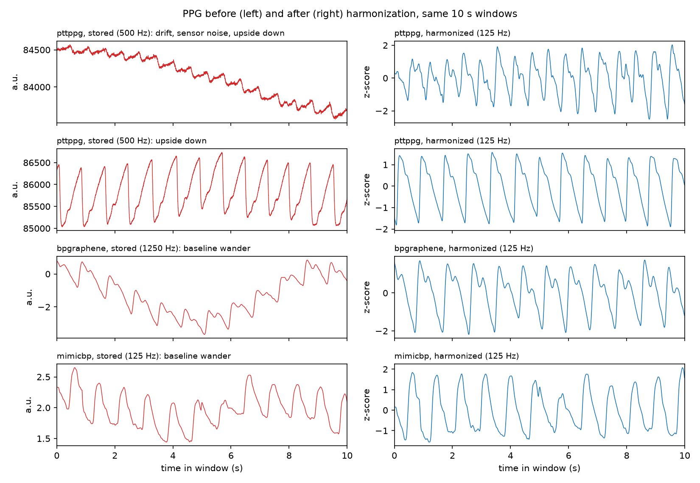

# Harmonization: summary

Short version of `harmonization_description.md` (details, numbers and justifications there).

## Goal and data

- 6 datasets → one format: **10 s windows, 125 Hz, 1 PPG (z-scored) + pressure wave (mmHg) + BP labels**
- Test set: ppgbp, pttppg, bpgraphene, mimicbp, pwdb complete; pulsedb 40 subjects
- Windows kept: mimicbp 135 622 · pulsedb 37 114 · pwdb 4374 · bpgraphene 1765 · pttppg 792 · ppgbp 657
- Very different sources: ICU, surgery, rest/exercise, simulation; native rates 125–1250 Hz; records 0.8 s to 10 h

## Pipeline (per record)

| # | Step | What | Key choice |
|---|---|---|---|
| 1 | Select signals | 1 finger PPG + pressure wave (if available) | pttppg `ppg_2` (clean + typical shape); pwdb brachial ABP (matches labels) |
| 2 | PPG orientation | Flip pttppg (stored upside down) | Fixed per dataset, not per window |
| 3 | Usable segments | Remove NaN edges/gaps and Finapres calibrations | Calibration = < 2 mmHg change for 0.5 s, ±1 s margin |
| 4 | Beat quality | Drop implausible beats | SBP 60–250, DBP 30–150, PP ≥ 10 mmHg; drops 0.03–0.23 % of beats |
| 5 | Place windows | Non-overlapping 10 s windows | Cuff reading only valid within ±60 s; short records keep their own length |
| 6 | Beat count | Reject < 0.5 beats/s | = 30 bpm, slowest the detector accepts |
| 7 | Padding | Cut with 2 s extra signal on both sides | Edge error 0.37 SD → 0.003 SD |
| 8 | Resample | 125 Hz, polyphase (`resample_poly`) | Native rate of ~95 % of windows; fewer edge effects than FFT |
| 9 | Band-pass (PPG only) | 0.5–15 Hz, Butterworth order 2, zero-phase | Removes drift (38 % of pttppg power) and noise; literature-backed band |
| 10 | Normalize (PPG only) | z-score per window | PPG amplitude has no unit (SD differs by 10⁴ across datasets) |
| 11 | PPG vs. pressure beats | Reject if peak counts differ by > 2 | Rejects ~1–2 % of windows |
| 12 | Output | `waves/*.h5`, `windows.parquet`, `bp.parquet`, `subjects.parquet`, `report.csv` | One folder per config (e.g. `default`, `no_bandpass`) |

## Open points / limitations

- Step 11 also rejects windows with irregular rhythm (e.g. premature beats) where neither signal is faulty. An alternative method may be needed.
- First/last window of a record or PulseDB segment has no padding on that side, so its outer ~0.7 s is slightly distorted.

## Example: before vs. after

- Stored PPG with obvious problems (left) → clean pulse wave after harmonization (right)
- **Drift / baseline wander** (rows 1, 3, 4): removed by the 0.5–15 Hz band-pass (step 9)
- **Sensor noise** (row 1): removed by the band-pass and the anti-aliasing filter of the resampling (steps 8, 9)
- **Upside down** (rows 1, 2): corrected by the orientation flip (step 2)
- **Different scales** (85 000 vs. 2 a.u.): unified by the z-score (step 10)
